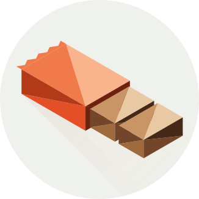
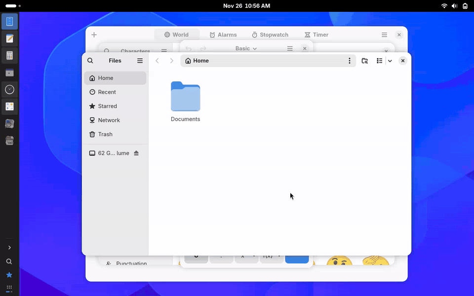
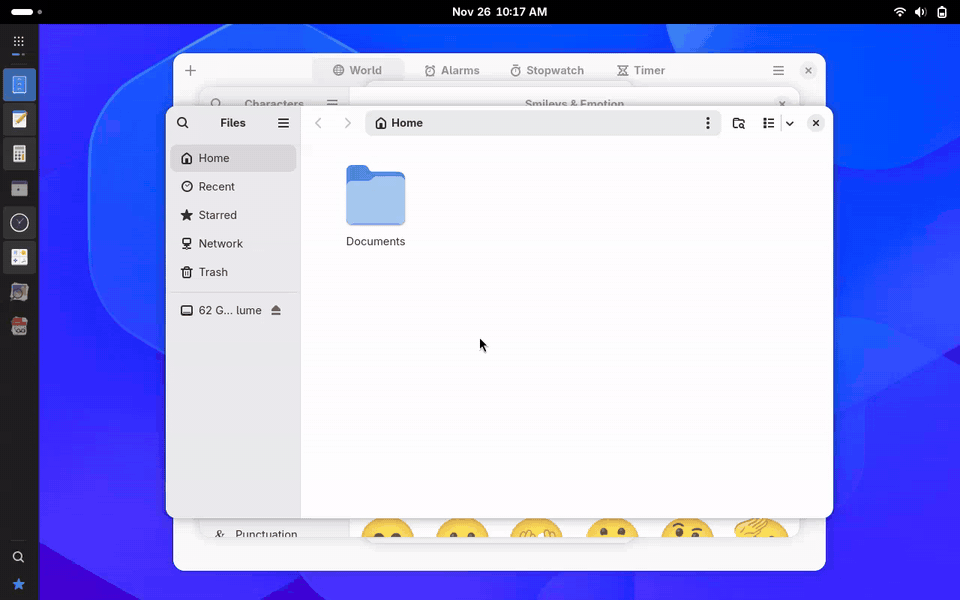
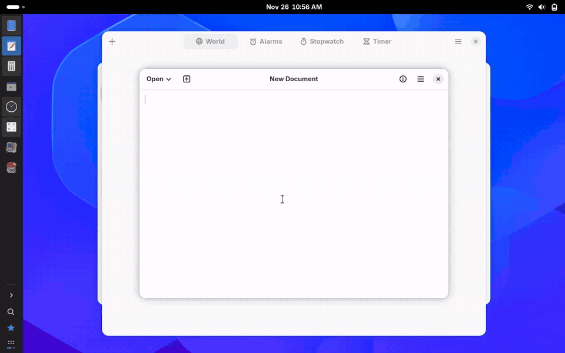
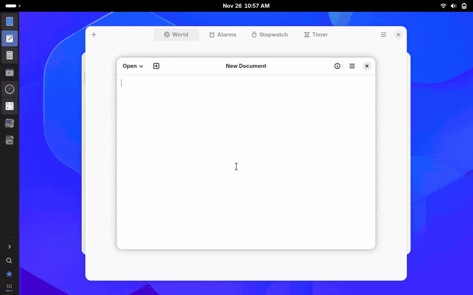
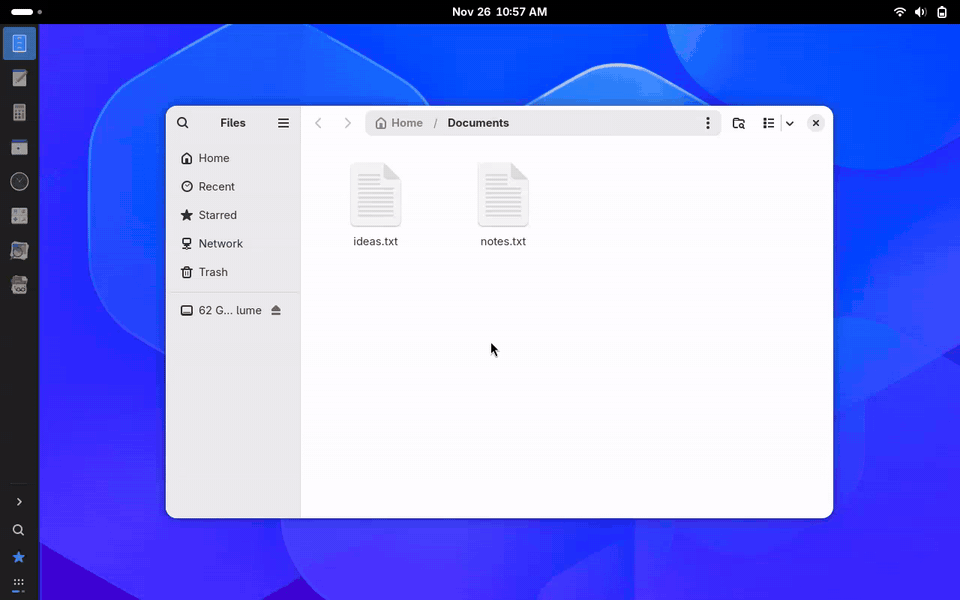
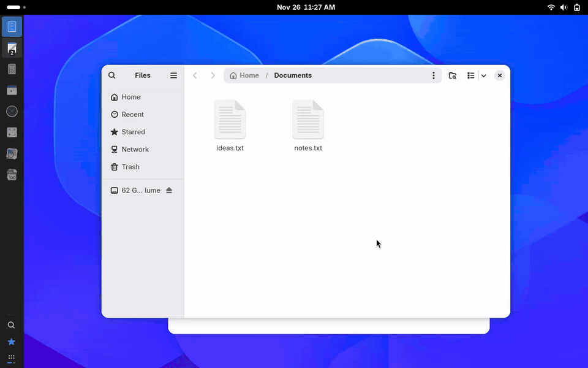
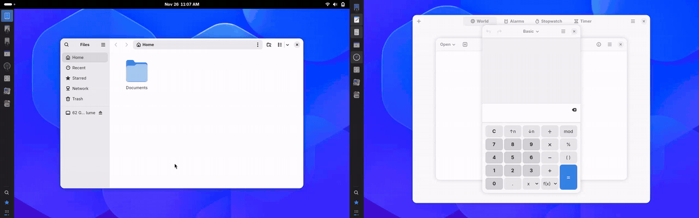

#  Barretta

A light app bar for GNOME Shell: zero calories for your CPU.

Barretta plays in the same league as [Dash to Dock](https://github.com/micheleg/dash-to-dock) and
[Dash to Panel](https://github.com/home-sweet-gnome/dash-to-panel), but with a different goal. Those
extensions can be tuned in hundreds of ways; Barretta cuts the customization down to the few choices
that matter (size, position, tray, autohide) and spends the effort on a handful of features I find
handy every day instead: finding a window by typing, seeing at a glance what is open on which screen,
dropping a file on an app that isn't in front. It also brings back the system tray (AppIndicator icons),
which GNOME doesn't have on its own.

It stays out of the way: while you aren't using it, it runs no timers and does no work.

## Features

### Find a window by typing

<kbd>Super</kbd>+<kbd>F</kbd> (or the lens at the bottom of the bar) searches the open windows by
title, app or desktop. <kbd>Enter</kbd> goes to the window; <kbd>Ctrl</kbd>+<kbd>Enter</kbd> keeps the
bar filtered, and the lens turns into a funnel: click it to clear the filter.



### Favorites on, or open apps only

The star at the bottom switches between your favorites plus the open apps, and the open apps only.



### Notifications and progress

A round badge counts the app's notifications, from GNOME's notifications or from the app itself (the
same count Telegram, Thunderbird and others publish for docks). Downloads and copies show their
progress as a ring inside the tile.



### System tray (AppIndicator)

The icons apps put in the tray (StatusNotifierItem/AppIndicator, the kind sync clients, chat and VPN
apps use) live at the bottom of the bar, with their menus. Keep them in a drawer, show some or all of
them in the bar, or turn the tray off: no separate AppIndicator extension needed.



### Drag a file onto an app

Drag a file over an icon and hold it there: four marks turn around the tile, then the app's window
comes to the front and you drop the file in it. If the app is closed, the wait is a little longer
(a second instead of half) and then the app opens.



If the app has more than one window, its previews open right away: hold the file on the one you want
and that window comes to the front. The previews stay open until the file leaves them, so you can still
pick another one.



On Wayland the shell can't receive the dragged file itself, so the drop happens in the window, not on
the icon.

### More than one screen

Each screen has its own bar, with its own windows. A pill under the icon says how many windows are
here and how many elsewhere (no zeros, no lonely "1"). Right-click lists the windows grouped by screen
and desktop; <kbd>Shift</kbd>+click brings a window from another screen to this one.



### And also

- Window previews on hover; close a window from its preview with × or a middle click.
- Drag icons to reorder them. The order is also the order of <kbd>Super</kbd>+<kbd>1</kbd>…<kbd>9</kbd>.
- Keep an app first in the bar for the session, without pinning it.
- Right-click menu with the app's windows, recent files, actions, pin/unpin and quit.
- Autohide (off by default).
- Translated into 39 languages; English by default.

## Mouse and keyboard

| On an icon | |
|---|---|
| Click | Bring the app forward, or open it; on the active app, cycle its windows or minimize |
| <kbd>Shift</kbd>+click | Bring the window here from another screen |
| Middle click, <kbd>Ctrl</kbd>+click | Open a new window |
| Right-click, <kbd>Menu</kbd>, <kbd>Shift</kbd>+<kbd>F10</kbd> | App menu |
| <kbd>Shift</kbd>+wheel | Cycle the app's windows |
| Drag | Reorder |

| Anywhere | |
|---|---|
| <kbd>Super</kbd>+<kbd>F</kbd> | Search windows |
| <kbd>Super</kbd>+<kbd>B</kbd>, <kbd>Ctrl</kbd>+<kbd>Alt</kbd>+<kbd>Tab</kbd> | Move the keyboard focus to the bar |
| <kbd>Super</kbd>+<kbd>1</kbd>…<kbd>9</kbd> | Open or focus the nth app of the bar |
| <kbd>Super</kbd>+<kbd>Ctrl</kbd>+<kbd>1</kbd>…<kbd>9</kbd> | New window of the nth app |
| Wheel on the apps button | Switch desktop |

## Settings

Right-click an empty spot of the bar, or the apps button: size, position (left, right or bottom),
tray and autohide are all there. There is no separate preferences window.

## Install

Barretta needs GNOME Shell 50 or 51.

```bash
git clone https://github.com/trikko/barretta.git
```

```bash
cd barretta && ./install.sh
```

Log out and back in (on Wayland GNOME loads a new extension only at login), then:

```bash
gnome-extensions enable barretta@andreafontana.it
```

If you use Dash to Dock or Dash to Panel, disable it first: two bars on the same edge don't get along.
The same goes for the AppIndicator extension: disable it, or set Barretta's tray to Off, so the icons
don't end up in two places.

To update, pull and run `./install.sh` again, then log out and back in.

## Translations

The sources are in `po/`. After editing a `.po` file, `./compila-traduzioni.sh` updates the template
and compiles the catalogs into the extension.

## Feedback & support

Using Barretta? I'd love to hear how it works for you, or what's missing: open an
[issue](https://github.com/trikko/barretta/issues), or write to me: the address is just **oss**, at
the domain of [my website](https://andreafontana.it).

Barretta is built in my spare time. If it's useful to you or your company,
consider [sponsoring me on GitHub](https://github.com/sponsors/trikko)
or [buying me a beer on PayPal](https://paypal.me/andreafontana) ❤️

## License

[GPL-3.0-or-later](LICENSE).
